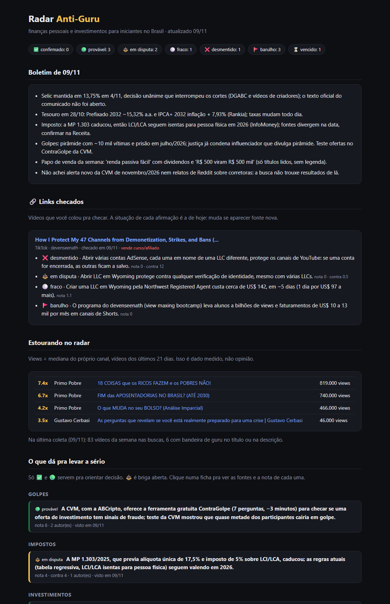

# 📡 Radar Anti-Guru

**Todo dia, o Radar lê o que a comunidade do seu nicho está falando e separa o que tem prova do papo de guru.**

**E você pode colar o link de qualquer vídeo** (YouTube, TikTok, Instagram, X, Kwai, Facebook...) **pra ele checar se o que é dito ali é verdade.**

Ele junta vídeos da semana no YouTube, canais de referência, Reddit, X, notícias e fontes oficiais. Cada informação vira uma ficha com nota. A nota **não é a opinião da IA**: a IA só responde quem é a fonte, se ela vende alguma coisa e se mostra prova. Uma conta fixa faz o resto.

Funciona pra qualquer nicho: finanças, canal dark, marketing, fitness, programação, afiliados...



## Por que isso existe
Todo nicho tem guru: "R$ 30 mil por mês no automático", "ninguém fala disso", "nicho sem concorrência", e o curso no link da bio. Se você pede pra uma IA resumir esses vídeos, ela resume o papo de venda junto, porque vídeo de vendedor costuma ser bem argumentado.

O Radar inverte isso. A IA não decide em quem acreditar. Ela só preenche uma ficha sobre cada fonte, e a conta é sempre a mesma:

| | |
|---|---|
| **Quem é** | oficial 5 · dado medido 4 · imprensa 3 · criador com resultado conferível 2 · comunidade 1 · anônimo 0,5 · vendedor 0,5 |
| **Conta** | se a afirmação é um cálculo ("R$ 1.000 por mês viram R$ 181 mil"), a IA escreve a conta e **o programa refaz**: bateu, vale 4 a favor; não bateu, 4 contra. Sozinha, deixa no máximo 🟢, porque prova que a matemática fecha, não que as premissas valem |
| **Prova** | conferível +1 · só print 0 · nenhuma −0,5 |
| **Ganha com isso?** | se a afirmação ajuda a vender o curso, a mentoria ou o afiliado da própria fonte: nota × 0,3 |
| **Bandeira de guru** | cada uma tira 1 ponto: promessa de renda, “automático/passivo”, “ninguém te conta”, “sem concorrência”, “clonei”, print sem prova, quem ensina sem resultado próprio |
| **Idade** | fonte com mais de 90 dias vale metade |
| **Independência** | do mesmo autor ou site, só a melhor fonte conta |

Com a nota somada, cada ficha cai numa situação:

- ✅ **confirmado**: tem fonte oficial, ou nota ≥ 6 com 3 autores independentes
- 🟢 **provável**: nota ≥ 3
- ⚖️ **em disputa**: as fontes contra somam metade ou mais
- ⚪ **fraco**: ainda não dá pra confiar (não quer dizer que é mentira, só que ninguém confirmou)
- ❌ **desmentido**: fonte oficial diz o contrário, ou o lado contra vale o dobro
- 🚩 **barulho**: nota baixa e metade das fontes com bandeira de guru. Fica guardado pra você reconhecer o papo quando aparecer de novo
- ⌛ **vencido**: 60 dias sem ninguém falar (regra oficial não vence)

Quem vende curso ou mentoria vai pra lista de vendedores, e tudo o que essa pessoa disser depois já entra com nota menor.

## O que você precisa
- **[Claude Code](https://docs.claude.com/claude-code)** instalado e logado (a análise e a busca na web são feitas por ele, usando o seu plano)
- **Python 3.9 ou mais novo** ([python.org](https://www.python.org/downloads/); no Windows, marque “Add Python to PATH”)
- O resto (o leitor do YouTube, `yt-dlp`) o próprio Radar instala

## Instalar (2 comandos)
Dentro do Claude Code, digite:

```
/plugin marketplace add AIFellps/radar-anti-guru
/plugin install radar@radar-anti-guru
```

Depois:

```
/radar:configurar
```

O Radar pergunta qual é o seu nicho, o que você quer saber e quem você acompanha, e monta a configuração sozinho. Você não precisa editar arquivo.

## Usar
| Comando | O que faz |
|---|---|
| `/radar:checar <link>` | checa um vídeo de qualquer rede: separa as afirmações, confere cada uma na web e dá o veredito pela conta fixa (funciona sem configurar nada) |
| `/radar:configurar` | monta ou troca a configuração do seu nicho |
| `/radar:ronda` | faz a ronda agora e abre o painel no navegador |
| `/radar:perguntar` | pergunta o que o Radar já sabe (“isso é verdade?”, “esse cara é guru?”). Se ele não souber, guarda a pergunta e a próxima ronda vai atrás |
| `/radar:agendar` | liga a ronda automática todo dia (Agendador do Windows ou crontab) |

## Checar um vídeo
```
/radar:checar https://www.tiktok.com/@alguem/video/123...
```
1. O Radar lê o vídeo: quem postou, a descrição e o que é dito (pela legenda; se não houver, ele transcreve o áudio no seu computador).
2. Marca as bandeiras de guru pela regra fixa: promessa de renda, “link na descrição”, “nosso programa”, afiliado, cupom...
3. Separa de 3 a 6 afirmações conferíveis e procura cada uma na web, a favor e contra: fonte oficial, imprensa, relatos independentes.
4. A conta fixa dá a situação de cada afirmação. Resultado real, com um TikTok que ensina a "blindar 47 canais" com uma empresa nos EUA:

> TikTok de um criador que diz rodar 47 canais de automação e vende o programa dele no fim (o Radar o registrou como vendedor).
> - ❌ **"Uma conta de AdSense por empresa protege os canais"**: desmentido. As páginas oficiais do AdSense e do YouTube dizem o contrário.
> - ⚖️ **"Abrir a empresa em Wyoming esconde o dono de qualquer verificação"**: em disputa.
> - ⚪ **"A empresa custa US$ 142 e fica pronta em uns 5 dias"**: fraco, não deu pra confirmar.
> - 🚩 **"Alunos com bilhões de views e US$ 10 a 13 mil por mês"**: barulho. A única fonte é o próprio vídeo, sem prova, terminando no convite pro programa.
>
> Nota da conta fixa, não da opinião da IA.

O vídeo vira ficha da sua base. Se outra pessoa repetir a mesma coisa, o Radar já sabe.

**Instagram e alguns vídeos do X e do Facebook pedem login.** O Radar usa a sua sessão do navegador (`--navegador firefox`, `chrome`, `edge` ou `brave`), e os cookies ficam no seu computador. No Windows, o Chrome às vezes bloqueia essa leitura; o Firefox funciona.

**Vídeo sem legenda (comum no TikTok e no Instagram):** na primeira vez, o Radar pede pra instalar a transcrição (faster-whisper, uns 500 MB contando o modelo). Um vídeo de 10 minutos leva uns 3 minutos pra transcrever num PC comum.

## O painel
O painel é uma página só (`painel.html`) com o boletim do dia, o que está estourando nos canais que você acompanha, as fichas por tema, o barulho e os vendedores.

## Onde ficam os seus dados
Em `~/radar-anti-guru/` (no Windows, `C:\Users\<você>\radar-anti-guru\`). Pra usar outra pasta, defina a variável `RADAR_PASTA`. Nada sai do seu computador além das buscas.

```
config.json        o seu nicho, buscas e canais
fichas.json        tudo o que o Radar sabe, com a nota da conta fixa
vendedores.json    quem vende curso/mentoria/afiliado
painel.html        o painel
links/             os vídeos que você mandou checar
coletas/           a foto crua do YouTube de cada dia
mudancas/          o que a IA achou em cada ronda (fontes descritas, sem nota)
```

## Custos e limites
- A coleta do YouTube não usa chave nem gasta nada.
- A análise usa o seu plano do Claude Code: Sonnet nos dias comuns e Opus na revisão de domingo. Dá pra trocar em `modelo` e `modelo_semanal` no `config.json`.
- Reddit e X são lidos pela busca na web: o Reddit fechou a API pra script pessoal.
- Se o YouTube bloquear por excesso de pedidos (erro 403), o Radar espera e tenta de novo. O que falhar fica registrado e a ronda segue com o resto.
- Os pesos são uma primeira versão. Se você achar um jeito melhor de contar, abra uma issue.

## Rodar sem o Claude Code (só a parte do YouTube)
```
python radar/radar.py exemplo financas     # ou canal-dark
python radar/radar.py coletar
```

## Licença
MIT. Use, mude e compartilhe à vontade.
